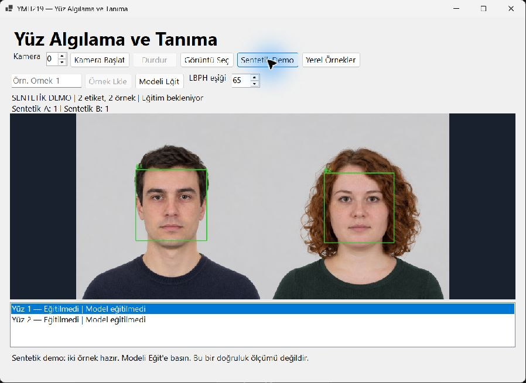
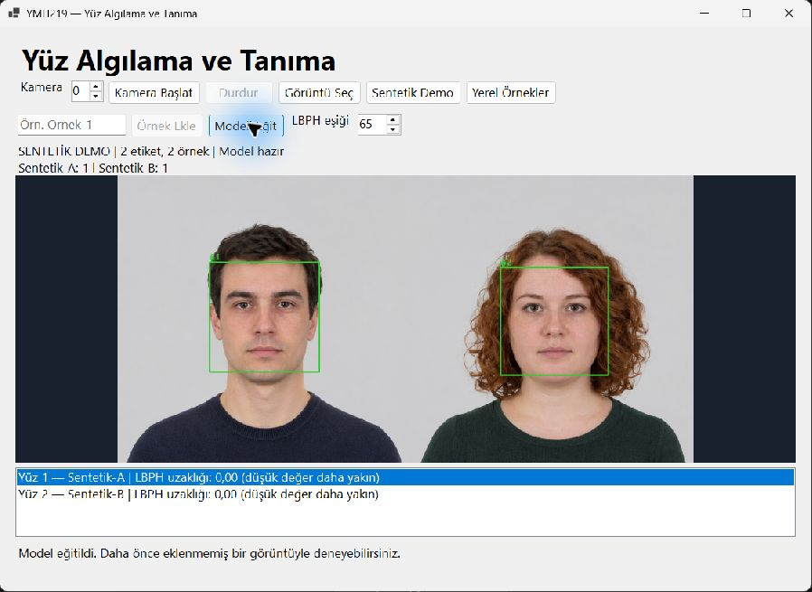

# YMH219 — Yüz Algılama ve Tanıma

Özgür Ulusoy — 250541083

C# Windows Forms üzerinde OpenCV ile yüz algılama ve küçük bir yerel örnek kümesinde etiket tahmini yapan ders uygulaması. Kameradan veya görüntü dosyasından alınan yüzler dikdörtgenle işaretlenir. LBPH modeli, kullanıcının eklediği örneklerden eğitilir.

## Teknolojiler

- C#, .NET 10, Windows Forms; Windows x64
- OpenCvSharp4.Windows 4.13.0.20261107
- Haar Cascade yüz algılama ve LBPH yüz tanıma
- Yerel PNG örnekleri ve JSON etiket listesi

## Kurulum ve çalıştırma

Windows x64 ve .NET 10 SDK gereklidir. Kamera için çalışan bir kamera ve Windows'ta masaüstü uygulamalarına kamera erişimi gerekir. Kamerasız kullanımda görüntü dosyası ve sentetik demo kullanılabilir.

```powershell
git clone https://github.com/ulusoyozgur/YMH219-FaceRecognition.git
cd YMH219-FaceRecognition
dotnet restore YMH219-FaceRecognition.sln
dotnet run --project FaceRecognition/FaceRecognition.csproj
```

Visual Studio'da .NET masaüstü geliştirme bileşenleriyle `YMH219-FaceRecognition.sln` açılarak da çalıştırılabilir. NuGet ilk kurulumda internet gerektirir; uygulama çalışırken internet kullanmaz. Algılama modeli ve demo görseli derleme klasörüne otomatik kopyalanır. Yalnızca EXE dosyasını taşımak yeterli değildir.

## Hızlı demo

1. **Sentetik Demo** düğmesine basın. İki kurgusal yüz çerçevelenir ve iki örnek etiketi hazırlanır.
2. **Modeli Eğit** düğmesine basın. Sonuç listesinde `Sentetik-A` ve `Sentetik-B` etiketleri ile LBPH uzaklığı görünür.
3. **Yerel Örnekler** düğmesiyle kendi örnek kümenize dönün.

Demo görseli yapay olarak üretilmiştir; gerçek kişilere ait fotoğraf veya kimlik içermez. Demo, eğitimde kullanılan aynı görüntü üzerinde çalıştığı için görünen sıfıra yakın uzaklık bir doğruluk başarısı veya bağımsız test sonucu değildir. İki etiketli temel işleyişi gösterir.

## Kendi örneklerini ekleme

1. **Yerel Örnekler** seçiliyken **Görüntü Seç** ile PNG, JPEG veya BMP açın; ya da kamera numarasını seçip **Kamera Başlat** düğmesine basın.
2. Yüzlerin numaralarını görüntüden takip edin. Kamera kullanırken **Durdur** ile uygun kareyi sabitleyin.
3. Sonuç listesinden yüzü seçin, etiketini yazın ve **Örnek Ekle** düğmesine basın. Yalnızca seçilen yüz bölgesi kaydedilir.
4. En az iki farklı etiket ekleyin. Her etiket için farklı açı ve ışıkta birkaç örnek eklemek daha iyi sonuç verir. Kendi yüzünüzün farklı örneklerini ayrı ders etiketleriyle de kullanabilirsiniz.
5. **Modeli Eğit** düğmesine basın. Ardından eğitimde kullanılmamış bir fotoğraf açın veya kamerayı başlatın.

Yeni örnek eklendiğinde eski model geçersizleşir; yeniden eğitim gerekir. Örnekler uygulama kapandığında korunur, eğitilmiş model bellekte tutulur. Yeniden açılışta **Modeli Eğit** ile örneklerden tekrar eğitilir.

## Özellikler ve sonuçların anlamı

- Bir karede birden fazla yüzü işaretleme ve ayrı sonuç gösterme
- Kamera başlatma/durdurma ve 0–9 kamera numarası seçimi
- İki veya daha fazla etiketle eğitim, örnek sayacı
- Ayarlanabilir LBPH uzaklık eşiği; eşik aşılırsa **Bilinmiyor** sonucu
- Eksik model, okunamayan görüntü, kamera erişim hatası ve geçersiz etiket için hata mesajları
- En fazla 200 örnek, etiket başına 40 karakter ve görüntü dosyası başına 30 MB sınırı

LBPH uzaklığı **güven yüzdesi değildir**. Küçük değer, örneğe daha fazla benzerlik anlamına gelir. Varsayılan eşik 65'tir; veri kümesine göre ayarlanmalıdır. Bu basit model hatalı eşleştirme yapabilir. Yandan çekim, düşük ışık, küçük yüzler ve kapalı yüzler algılamayı zorlaştırır. Büyük fotoğraflarda işlem kısa süre arayüzü bekletebilir.

## Yerel veriler

Örnekler `%LOCALAPPDATA%\YMH219-FaceRecognition\samples` altında tutulur. Sentetik demo ayrı `demo` klasörünü kullanır. Gerçek örnekler repository'ye veya internete gönderilmez. Kamera yalnızca başlatıldığında açılır; durdurmada ve uygulama kapanışında serbest bırakılır. Otomatik video kaydı yapılmaz. Ders çalışmasında kendi veya izinli yerel örnekler kullanılmalıdır.

## Ekran görüntüleri

Eğitim öncesi iki yüzün algılanması:



Eğitim sonrası sentetik örneklerin etiketlenmesi:



## Kontroller

```powershell
dotnet build YMH219-FaceRecognition.sln -c Release
dotnet run --project FaceRecognition.Checks/FaceRecognition.Checks.csproj -c Release
```

15 otomatik kontrol; gerçek OpenCV motoruyla iki yüzün algılanması, boş görüntü ve etiket reddi, en az iki etiket koşulu, örneklerin yeniden yüklenmesi, LBPH tahmini, parlaklık değişimi ve eşik reddini kapsar. Bunlar sentetik veriyle işlev kontrolleridir; gerçek kişiler üzerinde doğruluk ölçümü değildir.

Arayüzde demo, eğitim, kamera 0'ın açılıp kapanması ve olmayan kamera 9 için hata mesajı kontrol edildi. Kamera denemesinde yüz örneği kaydedilmedi.

## Kaynaklar ve varlıklar

- [OpenCvSharp](https://github.com/shimat/opencvsharp) ve [kullanılan NuGet paketi](https://www.nuget.org/packages/OpenCvSharp4.Windows/4.13.0.20261107)
- [OpenCV 4.12.0 Haar Cascade modeli](https://github.com/opencv/opencv/blob/4.12.0/data/haarcascades/haarcascade_frontalface_default.xml): `FaceRecognition/Assets` altında; modelin kendi lisans bildirimi korunmuştur. OpenCV lisansı da aynı klasördedir.
- `FaceRecognition/Assets/synthetic-demo.png`: yerleşik imagegen aracıyla oluşturulan iki kurgusal yetişkin portresi. İstem: yan yana, önden bakan, gözlüksüz, eşit aydınlatılmış, gri arka planlı iki farklı kurgusal yüz; yazı ve gerçek kişi referansı olmadan.
